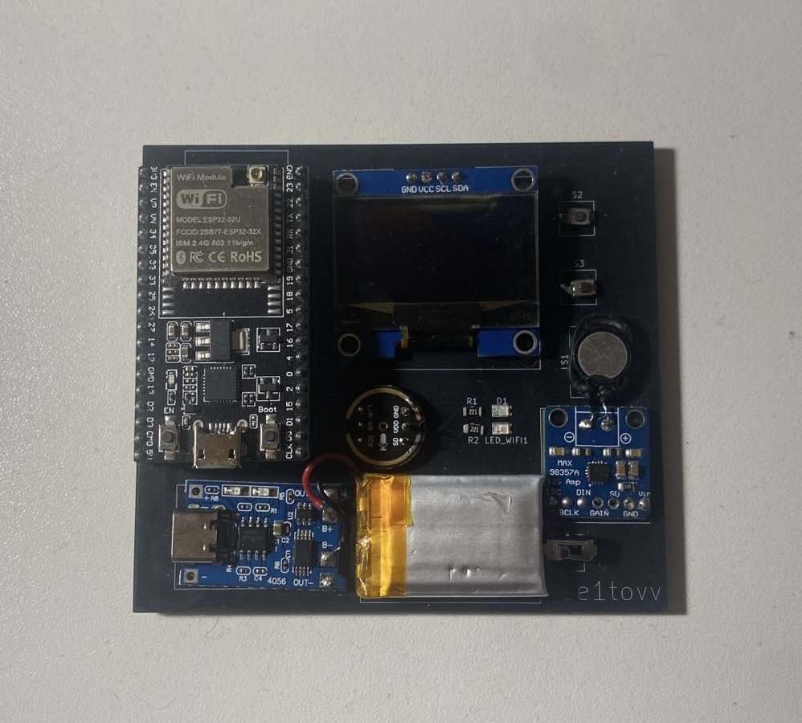

# MiniJarvis

A real-time voice assistant I designed and built from scratch — custom circuit drawn in **KiCad**, laid out and **fabricated as my own PCB**, running **ESP32** firmware plus a **Python** server. It listens, transcribes speech **offline** with Vosk, sends the text to GPT, and answers back on a **128×64 OLED**, out loud through a speaker — and can drive my PC and TV over the network.



## Recent updates
-  **Personality levels** — adjustable humor/wit, inspired by TARS in *Interstellar*.
-  **PC control over Wake-on-LAN** with **Gaming** and **Work** modes — game mode auto-opens/closes Steam and Minecraft; work mode opens KiCad, VS Code, and Claude.
-  **LG webOS TV control** via Wake-on-LAN — launch apps, control playback, and adjust volume.
-  **Multi-command chaining** — one voice prompt fires several commands across multiple devices at once.
-  **Faster response output.**

## Features
- Live speech recognition with an I2S **INMP441** microphone
- Real-time GPT replies via the OpenAI API
- Answer shown on a **128×64 OLED**
- Answer spoken through **MAX98357A** I2S amp + speaker
- Two language modes: **Russian & English**
- Scrollable multi-line OLED output
- Voice-activity LED indicator
- Fully offline STT (no internet needed after the model download)
- Modular — swap the ESP32 or peripherals via headers

## The build

I designed the circuit in KiCad and first breadboarded it on a **7×9 cm protoboard** — point-to-point soldered and brought up by hand, flashing and probing the wiring until every peripheral came alive. Once it worked, I laid out a proper **2-layer PCB**, had it fabricated, and assembled it (even silkscreened my handle on the board). The fabricated board at the top is what runs MiniJarvis today; it's powered by a 3.7 V LiPo through a TP4056 charger, so it runs untethered.

**From schematic to board:**

| KiCad schematic | Protoboard MVP (front) | Protoboard MVP (back) |
| --- | --- | --- |
|  |  |  |

**Core parts**
- Custom 2-layer PCB (designed in KiCad, fabricated by JLCPCB) — grew out of the 7×9 cm protoboard MVP
- ESP32-32U module
- INMP441 I2S microphone
- MAX98357A I2S amplifier + speaker
- 128×64 I2C OLED display
- 2× status LED (Wi-Fi/thinking, mic-active), 2× SMD button (language / scroll)
- Power switch, female headers + male connectors
- TP4056 charging module + 3.7 V 250 mAh LiPo

## Software used
- Arduino IDE (ESP32 firmware)
- VS Code (Python server)

## How it works
1. ESP32 connects to Wi-Fi and the server
2. OLED asks the user to select a language (`RU` or `EN`)
3. User speaks into the microphone
4. Vosk transcribes the speech → sends the text to GPT
5. GPT returns a short answer
6. ESP32 prints the text on the OLED, streams 24 kHz PCM to the MAX98357A, and the LED shows speech vs. silence
7. Multi-line answers scroll with the scroll button

## Running the server

There is a single ESP32 firmware file you flash once. On the Python side I split the server into three files so you can bring it up step by step:

1. **`server/default.py`** — say *"Jarvis"* or *"Assistant"* to wake it. The LED should stay on while you speak. Ask a few questions, and once it's clean, move on.
2. **`server/advanced.py`** — adds full PC control (Wake-on-LAN, gaming/work modes). Try *"Jarvis, open Google Chrome"*, etc.
3. **`server/final.py`** — faster responses, plays music from YouTube and Apple Music (*"Jarvis, turn on Travis Scott"* opens YouTube; an extra command opens Apple Music on macOS), chains multiple commands in one prompt, and lets you switch languages by voice without re-initializing the ESP32 with the buttons. For the full command list, see `parse_and_execute_command`.

Start with the **small** Vosk models for a fast server start; they're less accurate, so once everything works, switch to the **larger** models for better recognition. Don't forget to allow VS Code to control the PC.

## Install (quick guide)

```bash
# 1. Clone
git clone https://github.com/se1tovvv/MiniJarvis.git
cd MiniJarvis

# 2. Download Vosk models, place them in /models

# 3. Install Python deps
pip install vosk openai

# 4. Add your OpenAI key — create server/config.py:
#    OPENAI_API_KEY = "your key"

# 5. Flash the ESP32 firmware (Arduino IDE)

# 6. Run the server (start with default, then advanced, then final)
python server/default.py
python server/advanced.py
python server/final.py
```

## Wiring

> The KiCad schematic above is the source of truth. On the ESP32-32U a few GPIOs (e.g. the LEDs) can differ from the tables below — use the ESP32 pinout and reassign as needed.

**INMP441 microphone**

| INMP441 Pin | ESP32 Pin | Notes |
| ----------- | --------- | ------------------ |
| VCC | 3V3 | Power |
| GND | GND | Ground |
| SCK (BCLK) | 26 | Bit clock |
| WS (LRCLK) | 25 | Left/right clock |
| SD | 22 | Data |
| L/R | GND | Force left channel |

**MAX98357A amplifier**

| MAX98357A Pin | ESP32 Pin | Notes |
| ------------- | --------- | ----------- |
| VIN | 3V3 | Power |
| GND | GND | Ground |
| BCLK | 14 | Bit clock |
| LRCLK/WSEL | 27 | Word select |
| DIN | 13 | Data |
| SD_MODE | not used | Mono |
| GAIN | not used | Default |
| SPK+ | Speaker+ | Output |
| SPK− | Speaker− | Output |

**OLED (I2C)**

| OLED Pin | ESP32 Pin | Notes |
| -------- | --------- | --------- |
| VCC | 3V3 | Power |
| GND | GND | Ground |
| SDA | 21 | I2C data |
| SCL | 23 | I2C clock |

**Buttons**

| Button | ESP32 Pin | Notes |
| --------------- | --------- | ---------------------------- |
| Language (RU) | 16 | One pin → ESP32, other → GND |
| Scroll / EN text | 4 | One pin → ESP32, other → GND |

**LEDs**

| LED | ESP32 Pin | Notes |
| -------------- | --------- | --------------------------------------- |
| Wi-Fi/Thinking | 2 | Anode → resistor → ESP32, cathode → GND |
| Mic Active | 15 | Same wiring |

**TP4056 charger**

| TP4056 Pin | Connects To |
| ---------- | ----------------------------- |
| B+ | LiPo + |
| B− | LiPo − |
| OUT+ | Power switch → ESP32 3V3 rail |
| OUT− | GND |
